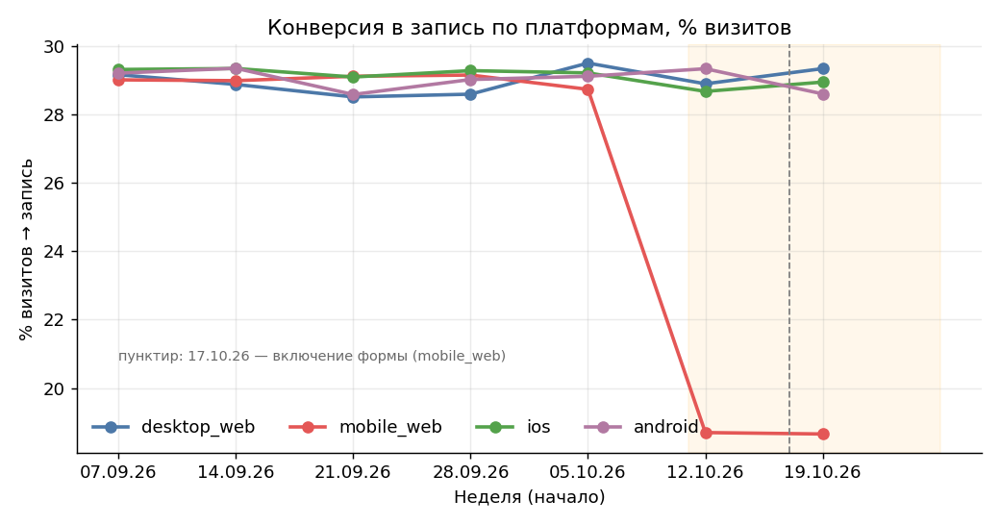

# Записка руководителю

Конверсия в запись упала с 29,05% до 25,87% (−3,18 п.п., −10,9%) за 12.10.26 - 25.10.26 против базы 07.09.26 - 11.10.26. Падение почти всё в mobile_web: 28,99% → 18,68%. Сломался переход — «выбор слота → вход в форму»: в mobile_web 69,06% → 44,23%. На этот шаг приходится 96% падения, mobile_web — −3,1 п.п. из −3,18. Другие платформы стабильны. Масштаб: 1,6 тыс. недополученных записей, 12% записей периода.

**Визуализация:** 

Данные чистые: 169 строк, дубликат удалён, проверки пройдены. Случайный разброс — десятые доли пункта, а падение 3,18 п.п. — это не шум.

Причина пока не подтверждена. Место слома известно, но релиз новой формы вышел 17.10.26, а падение началось 12.10.26 — по времени не подходит. Предполагаем: форму раскатывали раньше, чем указано в журнале, либо на вход повлияло другое изменение.

Предлагаю: 1) в течение дня посмотреть историю релизов и включений фича-флагов mobile_web за период 05.10.26 - 12.10.26; 2) за 05.10.26 - 19.10.26 сверить клиентские события с серверными заявками и выгрузить воронку по дням; 3) найденное изменение проверить экспериментом; метрика — доля выбравших слот, дошедших до формы.

Предполагаем, что вход сломало изменение, появившееся не позже 12.10.26. Какое именно — пока не подтверждено. Не исключаем сбой учёта: это покажет сверка с серверными заявками.
