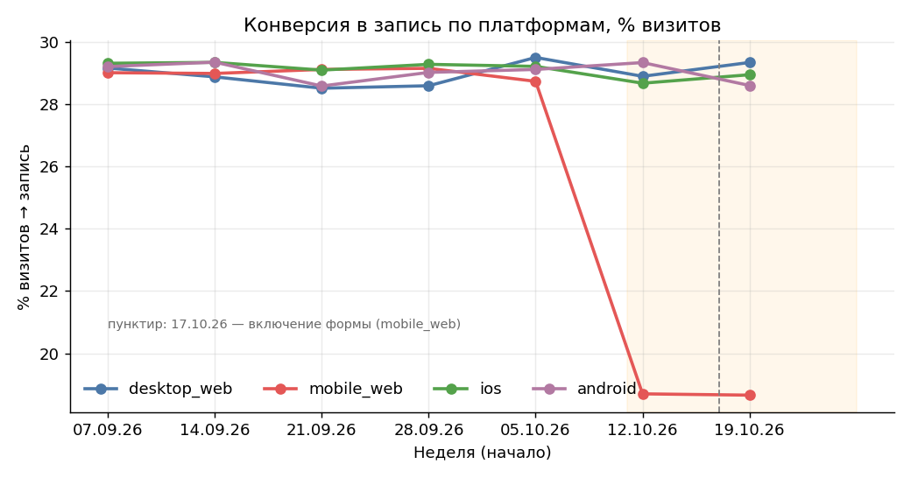

# Детальная записка: падение конверсии записи на mobile_web (v18)

## 1. Контекст и вопрос

Сервис записи к специалистам. Вопрос: почему за 12.10.26 - 25.10.26 конверсия в запись ниже, чем в базе 07.09.26 - 11.10.26. Единица анализа — уникальные пользователи внутри недели × платформы × категории × региона; знаменатель — визиты. База — 5 недель, текущий период — 2 недели.

## 2. Данные и проверки

169 строк, после удаления дубля (19.10.26, ios, beauty, capital; значения совпадают) — 168. Сетка 7 недель × 4 платформы × 3 категории × 2 региона полная, по 24 строки в неделю. Нулей, пропусков и нарушений порядка шагов нет. Границы периодов совпадают с неделями, пересечений нет. Чего в данных нет: дневной разбивки, серверных заявок, разреза по устройствам и браузерам.

## 3. Что произошло

Конверсия в запись 29,05% → 25,87%, это −3,18 процентного пункта (−10,9%). Доверительные интервалы 28,80% - 29,29% и 25,50% - 26,25% не пересекаются — падение не объясняется случайным разбросом.

## 4. Где и когда сломалось

- Переход «выбор слота → вход в форму»: 69,04% → 61,78% (−7,26 п.п.), 96,0% общего изменения. Остальные шаги — не более 2,6%.
- Платформа mobile_web: 28,99% → 18,68% (−10,31 п.п.), вклад −3,10; ios −0,44, android −0,08, desktop_web +0,18.
- Внутри mobile_web падение однородно: doctors −10,98, beauty −9,56, tutors −10,33 п.п.; capital −10,12, other −10,54.
- Трафик не менялся: сдвиг состава −0,0004 п.п., доля mobile_web 30,04% → 30,01%.
- Когда: перелом между 05.10.26 и 12.10.26 — шаг упал на 24,81 п.п., дальше плато 44,79%. Падение видно всю неделю 12.10.26, то есть к её началу эффект уже был полным. Новая форма (17.10.26) по времени не подходит: при включении в этот день недельная конверсия была бы около 62%, а не 44,23%.
- Масштаб: около 1 631 недополученной записи за две недели — 35,6% записей сегмента и 12,0% всех записей периода.

## 5. Альтернативы

Источник — журнал изменений `data/change_log.csv`: 8 записей. В таблице показано падение в сегменте события и в остальных платформах.

| событие | проверка | вывод |
|---|---|---|
| Задержки 24.09.26 и 10.10.26 | краткие ops-события, вне недели перелома | не объясняют |
| android 06.10.26 | падение −0,08 против −4,25 у остальных | следов нет |
| ios 14.10.26 и 20.10.26 | −0,44 против −4,01 | следов нет |
| mobile_web 17.10.26 | −10,31 против −0,12, но падение началось раньше | не может быть причиной перелома: релиз вышел позже |
| поддержка 21.10.26 | перезагрузка после выбора слота | механизм, не доказательство |
| кампания beauty 23.10.26 | после перелома, эффекта в данных нет | не объясняет |

Исключение релиза по времени не отменяет локализацию: место слома — вход в форму. Значит, на этот шаг повлияло другое изменение, и его нужно найти.

Дополнительно: шаг «форма → запись» стабилен, 86,0% → 86,1%. Значит пользователи реально не доходят до формы, а не теряются в учёте.

## 6. Гипотеза и механизм

Сломавшийся шаг локализован: вход в форму подтверждения на mobile_web. Но причина пока не подтверждена. По нашим данным, что изменение действовало не позже 12.10.26. Релиз новой формы (17.10.26) не может быть причиной этого перелома: падение началось раньше. Это не отменяет локализацию — на вход в форму повлияло другое изменение, и его ещё предстоит найти; возможно, это более ранняя раскатка той же формы.

## 7. План проверки и правило решения

1. Посмотреть историю релизов и включений фича-флагов mobile_web за 05.10.26 - 12.10.26 — кто и когда включал новую форму.
2. За 05.10.26 - 19.10.26 сверить клиентские события с серверными заявками и выгрузить воронку по дням.
3. Когда изменение найдено — проверить его откатом или A/B на метрике «слот → форма».
4. Правило: откат возвращает около 69% — причина подтверждена; возврата нет — искать дальше.

## 8. Что делать дальше

Место слома известно — шаг «выбор слота → форма подтверждения» в mobile_web. Конкретное изменение пока не подтверждено. Предполагаем, что его вызвало одно из изменений, появившихся не позже 12.10.26; чтобы это проверить, предлагаю посмотреть историю релизов и включений фича-флагов mobile_web за 05.10.26 - 12.10.26, сверить клиентские события с серверными заявками и выгрузить воронку по дням. Если совпадений в журнале не окажется, вероятно, журнал неполный — тогда стоит смотреть историю деплоев, серверные события и логи ошибок.

## Приложение: расчёт

# Детальный расчёт

В расчёте 168 строк воронки: 5 недель базы (07.09.26 - 11.10.26) и 2 недели текущего (12.10.26 - 25.10.26). Проблемный сегмент — mobile_web, ближайшее событие в журнале — 17.10.26.

## 1. Трафик на каждом шаге

| шаг | людей в базе | людей сейчас | доля от визитов, % | доля сейчас, % |
|---|---|---|---|---|
| Визит | 131 410 | 52 728 | 100,00 | 100,00 |
| Карточка | 105 376 | 42 177 | 80,19 | 79,99 |
| Слот | 64 297 | 25 659 | 48,93 | 48,66 |
| Форма | 44 393 | 15 852 | 33,78 | 30,06 |
| Запись | 38 172 | 13 641 | 29,05 | 25,87 |

Доля считается от всех визитов периода: из 100 пришедших до записи в базе доходили 29,05, сейчас — 25,87.

## 2. Где теряется трафик

| переход | доходило в базе, % | доходит сейчас, % | изменение, п.п. | вклад в общее падение, % |
|---|---|---|---|---|
| Визит→Карточка | 80,19 | 79,99 | -0,20 | 2,1 |
| Карточка→Слот | 61,02 | 60,84 | -0,18 | 2,6 |
| Слот→Форма | 69,04 | 61,78 | -7,26 | 96,0 |
| Форма→Запись | 85,99 | 86,05 | 0,07 | -0,7 |

Доля считается от визитов: сколько из пришедших доходит до следующего шага. Вклад показывает, какая часть общего падения приходится на этот переход; в сумме вклады дают 100%.

## 3. На каких платформах

| платформа | визитов в базе | визитов сейчас | конверсия в базе, % | конверсия сейчас, % | изменение, п.п. | вклад, п.п. |
|---|---|---|---|---|---|---|
| mobile_web | 39 471 | 15 826 | 28,99 | 18,68 | -10,31 | -3,10 |
| ios | 30 640 | 12 228 | 29,24 | 28,80 | -0,44 | -0,10 |
| android | 33 679 | 13 501 | 29,04 | 28,96 | -0,08 | -0,02 |
| desktop_web | 27 620 | 11 173 | 28,92 | 29,11 | 0,18 | 0,04 |

Вклад платформы — сколько процентных пунктов общего падения она даёт; в сумме это -3,18 п.п.

Состав трафика не менялся: доля mobile_web в визитах 30,04% → 30,01%, поэтому спад нельзя объяснить перетоком людей.

## 4. Когда началось падение

Доля перешедших на шаг «Слот→Форма» в mobile_web по неделям: 07.09.26 — 68,71% · 14.09.26 — 69,17% · 21.09.26 — 69,58% · 28.09.26 — 68,83% · 05.10.26 — 69,03% · 12.10.26 — 44,23% · 19.10.26 — 44,79%

- перепад mobile_web, Слот→Форма: 05.10.26 → 12.10.26: -24,81 п.п.
- перепад mobile_web, запись: 05.10.26 → 12.10.26: -10,02 п.п.
- перепад все платформы вместе: 05.10.26 → 12.10.26: -3,21 п.п.

Событие 17.10.26 попадает внутрь недели 12.10.26. До него доля перешедших держалась на 69,06%, после — 44,79%, а в неделе события — 44,23%.
Если бы падение началось ровно 17.10.26, за эту неделю вышло бы 62,13% против фактических 44,23% (слот выбрали 3 914 раз).
Расхождение слишком велико для случайного: падение действовало всю неделю, а значит, началось раньше даты события.

## 5. Что было в журнале изменений

Источник — файл `data/change_log.csv`, в нём 8 записей. Для каждой записи показано падение конверсии в её сегменте и в остальных платформах, а также вывод по данным.

| дата | событие | падение в его сегменте, п.п. | падение в остальных, п.п. | вывод |
|---|---|---|---|---|
| 24.09.26 | Краткая задержка синхронизации расписаний, 28 минут | -3,18 | — | до перелома: следов нет |
| 06.10.26 | Обновлено отображение карточки специалиста | -0,08 | -4,25 | следов в данных нет |
| 10.10.26 | Краткая задержка синхронизации расписаний, 35 минут | -3,18 | — | до перелома: следов нет |
| 14.10.26 | Обновлена версия SDK аналитики | -0,44 | -4,01 | следов в данных нет |
| 17.10.26 | Новая форма подтверждения записи включена для 100% пользователей | -10,31 | -0,12 | не может быть причиной этого перелома: падение началось раньше релиза |
| 20.10.26 | Новая версия приложения опубликована в магазине | -0,44 | -4,01 | следов в данных нет |
| 21.10.26 | В обращениях чаще упоминается перезагрузка страницы после выбора слота | -10,31 | -0,12 | механизм, не доказательство |
| 23.10.26 | Запущена рекламная кампания категории beauty | -3,18 | — | после перелома |

Для событий масштаба всего продукта в колонке «в его сегменте» показано общее падение за период, а не эффект события.

## 6. Сколько записей потеряно

Если бы mobile_web сохранил прежнюю конверсию, за две недели он дал бы 4 588,1 записей. Фактически — 2 957. Потеря — 1 631,1 записей: 35,6% записей платформы и 12,0% всех записей периода.

## 7. Проверки

- ✔ суммы по периодам сходятся: 131410 + 52728 = 184138
- ✔ все строки разложены по периодам: 120 + 48 = 168
- ✔ произведение долей по шагам равно итоговой конверсии: 0,258705 = 0,258705
- ✔ сумма вкладов шагов равна общему изменению: -0,115847 = -0,115847
- ✔ сумма долей равна 100%: 100,00%
- ✔ сумма визитов по платформам равна итогу: 131410 / 52728
- ✔ сумма вкладов платформ равна изменению внутри платформ: -3,1802 = -3,1802
- ✔ сумма вкладов платформ с учётом трафика равна общему изменению: -3,1775 = -3,1775
- ✔ внутри платформ + сдвиг состава + совместный эффект = общее изменение: -3,1802+-0,0004+0,0032 = -3,1775
- ✔ суммы по неделям равны итогу периода: суммы записей по неделям сходятся