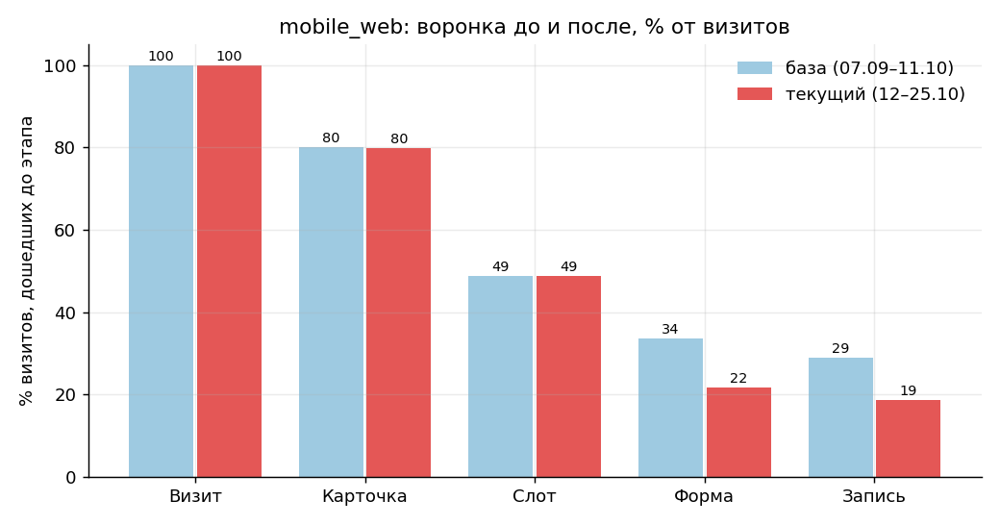
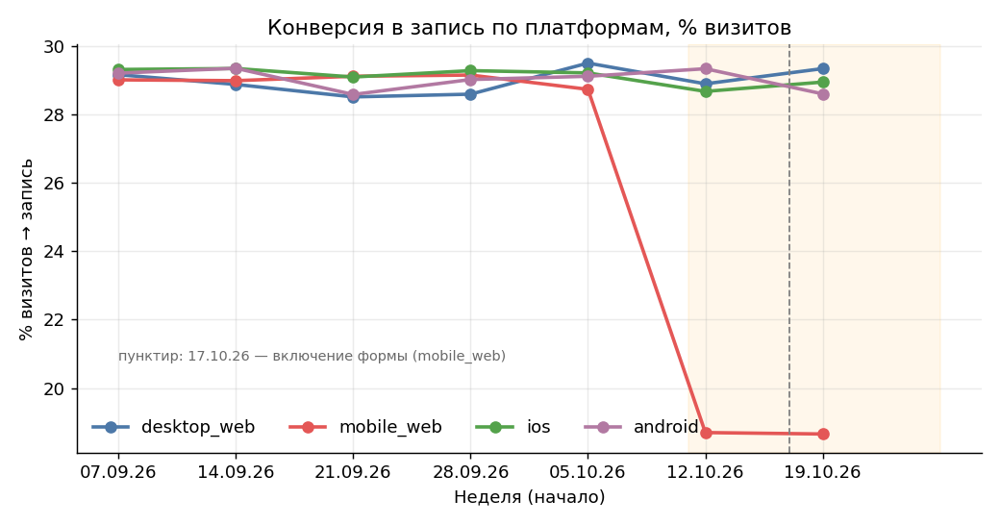
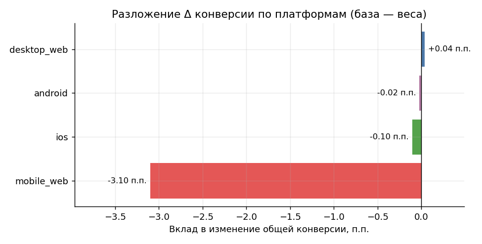
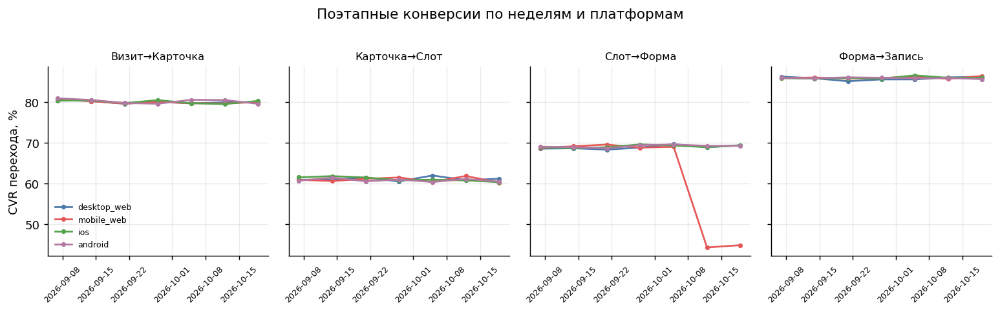
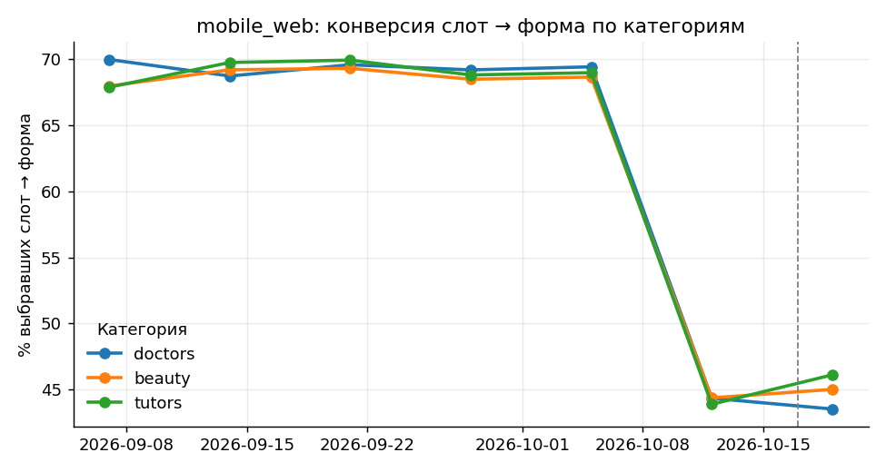

# Почему снизилась конверсия в запись

**Вывод в одну строку:** общая конверсия упала с 29,0% до 25,9% (−3,2 п.п., −11%),
почти весь спад даёт **mobile_web**, и ломается он ровно на одном шаге —
**«выбран слот → открылась форма подтверждения»**. Единственное объяснение,
которое совпадает и по платформе, и по этапу, — новая форма подтверждения
записи на mobile_web. Это гипотеза, а не доказанный факт: дата начала эффекта
в данных не совпадает с датой флага в журнале изменений.

Все расчёты: `analysis/analyze.py` → `analysis/tables/*.csv`, `charts/*.png`.
Запуск: `MPLCONFIGDIR=.mplconfig python3 analysis/analyze.py`.

---

## 1. Данные и методика

| Параметр | Значение |
|---|---|
| Единица строки | неделя × платформа × категория × регион (24 строки в неделю) |
| Единица анализа | уникальные пользователи внутри недели и сегмента |
| База | 07.09–11.10.2026, 5 недель: 07.09, 14.09, 21.09, 28.09, 05.10 |
| Текущий | 12–25.10.2026, 2 недели: 12.10, 19.10 |
| Основная метрика | `bookings_completed / visitors` |
| Переход этапа | следующий счётчик / предыдущий |
| Агрегация | суммирование счётчиков, затем деление (не среднее недельных конверсий) |

Границы периодов совпадают с границами недель: 05.10 покрывает 5–11.10 целиком,
12.10 и 19.10 покрывают 12–18.10 и 19–25.10. Разрезанных недель нет — это
упрощает сравнение, но у текущего периода всего 2 недели.

**Проверка ключа:** 169 строк, 168 уникальных ключей (7 × 24). Найден один дубль
`2026-10-19 / ios / beauty / capital`, значения счётчиков совпадают. Дальше работаем
с дедуплицированными данными. Влияние дубля на конверсию текущего периода —
25,93% против 25,87%, то есть 0,06 п.п., на выводы не влияет (`duplicate_impact.csv`).

---

## 2. Качество данных

| Проверка | Результат | Комментарий |
|---|---|---|
| Дубли ключа | 1 ключ, 2 строки | значения идентичны → дедупликация безопасна |
| Полнота недель | 24 строки в каждой из 7 недель | пропусков сегментов нет |
| Нули и отрицательные значения | 0 | деления на ноль нет |
| Монотонность воронки | 0 нарушений | каждый следующий счётчик ≤ предыдущего |
| Границы периодов | совпадают с неделями | см. выше |
| Дубль в агрегатах | +0,06 п.п. к конверсии | удалён |

Чего в данных **нет** и что ограничивает выводы: дневной разбивки (нельзя
датировать перелом точнее недели), сквозных user_id между неделями, устройства
и браузера, источника трафика, серверных (не клиентских) заявок, выручки.
Счётчики клиентские, поэтому «пользователь не дошёл» и «событие не отправилось»
по этим данным неразличимы — это закрывается в разделе 8.

---

## 3. Воронка: база и текущий период

| Этап | База, чел. | Текущий, чел. | Доля от визитов, база | Доля от визитов, текущий |
|---|---|---|---|---|
| Визит | 131 410 | 52 728 | 100% | 100% |
| Карточка специалиста | 105 376 | 42 177 | 80,2% | 80,0% |
| Выбор слота | 64 297 | 25 659 | 48,9% | 48,7% |
| Форма подтверждения | 44 393 | 15 852 | 33,8% | 30,1% |
| Запись завершена | 38 172 | 13 641 | **29,0%** | **25,9%** |



Видно, где именно рвётся: до выбора слота кривые совпадают, после — расходятся.

### 3.1. Разложение по этапам

| Переход | База | Текущий | Δ, п.п. | p-value | Вклад в Δ общей конверсии |
|---|---|---|---|---|---|
| Визит → Карточка | 80,19% | 79,99% | −0,20 | 0,33 | 2% |
| Карточка → Слот | 61,02% | 60,84% | −0,18 | 0,52 | 3% |
| **Слот → Форма** | **69,04%** | **61,78%** | **−7,26** | **<0,001** | **96%** |
| Форма → Запись | 85,99% | 86,05% | +0,07 | 0,84 | −1% |

Вклад — из мультипликативного разложения общей конверсии (сумма логарифмов
отношений этапных CVR). Первые два перехода и последний статистически не
изменились; весь сдвиг — в одном звене. Важно, что «Форма → Запись» не выросла:
если бы сломалась только отправка события `booking_starters`, доля дошедших до
записи из формы подскочила бы. Она не подскочила.

---

## 4. Сегменты: где именно

| Платформа | Визиты, база | Визиты, текущий | Конверсия, база | Конверсия, текущий | Δ, п.п. | Вклад, п.п. |
|---|---|---|---|---|---|---|
| desktop_web | 27 620 | 11 173 | 28,92% | 29,11% | +0,18 | +0,04 |
| **mobile_web** | **39 471** | **15 826** | **28,99%** | **18,68%** | **−10,31** | **−3,10** |
| ios | 30 640 | 12 228 | 29,24% | 28,80% | −0,44 | −0,10 |
| android | 33 679 | 13 501 | 29,04% | 28,96% | −0,08 | −0,02 |
| **Итого** | **131 410** | **52 728** | **29,05%** | **25,87%** | **−3,18** | **−3,18** |




Три платформы стоят на месте (от −0,4 до +0,2 п.п. — в пределах шума),
mobile_web падает на 10,3 п.п. и даёт −3,10 из −3,18 п.п. общего спада.

Эффект **не зависит от сегмента внутри mobile_web**:

| Разрез | Δ конверсии, п.п. |
|---|---|
| mobile_web: doctors / beauty / tutors | −10,98 / −9,56 / −10,33 |
| mobile_web: capital / other | −10,12 / −10,54 |
| Все категории (все платформы) | doctors −3,12; beauty −3,30; tutors −3,10 |
| Все регионы | capital −3,16; other −3,21 |

Однородность по категориям и регионам — сильный аргумент против объяснений
«изменился состав трафика» и «кампания в beauty»: смена состава задела бы
сегменты по-разному.

**Разложение на rate/mix:** внутриплатформенный эффект −3,18 п.п., эффект сдвига
трафика 0,00 п.п. Посетители mobile_web при этом стабильны: 7 894 в неделю в базе
против 7 913 в неделю сейчас. То есть люди приходят те же, а конверсия падает —
это не «пришёл другой трафик».

---

## 5. Динамика: когда началось

| Неделя | mobile_web: слот → форма |
|---|---|
| 07.09 | 68,7% |
| 14.09 | 69,2% |
| 21.09 | 69,6% |
| 28.09 | 68,8% |
| 05.10 | 69,0% |
| **12.10** | **44,2%** |
| **19.10** | **44,8%** |




Это ступенька, а не плавный тренд: пять недель в коридоре 68,7–69,6%, затем
обвал сразу на 25 п.п. и стабилизация. Все три категории mobile_web падают
одновременно и на одну величину.

**Расхождение с журналом изменений.** Флаг новой формы датирован 17.10.
Если бы эффект начался 17.10, два дня из семи в неделе 12.10 были бы
«чистыми», и недельная конверсия составила бы ≈62,1% (5/7 × 69,1% + 2/7 × 44,8%).
Наблюдаем 44,2%; z = −23,1. Подразумеваемая доля недели под воздействием — 102%,
то есть эффект присутствовал **всю неделю с 12.10**. Прямое следствие: либо
раскатка началась раньше, а 17.10 — дата достижения 100%, либо на mobile_web
12.10 произошло что-то ещё, чего нет в журнале. Журнал также не гарантирует
полноту, а его даты могут отражать завершение, а не начало изменения.

---

## 6. Гипотеза и альтернативы

### Что установлено (факты)

1. Общая конверсия упала на 3,2 п.п. (−11%), и это падение записей, а не метрики:
   число записей на визит упало с 29,0% до 18,7% на mobile_web при стабильном трафике.
2. Спад локализован: одна платформа (mobile_web) и один этап (слот → форма).
3. Эффект однороден по категориям и регионам и начинается с недели 12.10.
4. Сдвига состава трафика нет (mix-эффект ≈ 0), сезонная общая причина маловероятна —
   остальные три платформы в те же недели не изменились и работают внутренним контролем.
5. Оценка масштаба: ≈1 630 недополученных записей за две недели — 35,6% записей
   mobile_web и 12,0% всех записей периода (контрфакт: конверсия mobile_web как в базе).

### Гипотеза (не факт)

> Сломался именно вход в форму подтверждения на mobile_web. Причина — изменение,
> действовавшее не позже 12.10.2026; конкретный релиз не установлен. Релиз новой
> формы от 17.10.2026 как причина исключается по времени: падение уже полное
> в неделе 12.10.

За локализацию: совпадает платформа (только mobile_web), совпадает шаг (вход
в форму, а не карточка и не завершение), совпадает величина и резкость, эффект
однороден по категориям и регионам. Против версии «виноват релиз 17.10»: падение
было уже полным в неделе 12.10 — при включении 17.10 неделя дала бы ≈62%, а не
44,23%. Открыто: какой именно релиз или переключение флага действовало 12.10,
и не является ли часть спада сбоем учёта.

### Альтернативы и чем они закрываются

| Альтернатива | Проверка по данным | Вердикт |
|---|---|---|
| Задержки синхронизации 24.09 и 10.10 (все платформы) | краткие ops-события; в недельных агрегатах нет провала ни на одном этапе и ни на одной платформе | не объясняет |
| Обновление карточки на android 06.10 | android: конверсия 29,01% → 28,99%, этапные CVR плоские | не объясняет |
| SDK аналитики на ios 14.10 | ios: −0,4 п.п. (в пределах шума); если бы артефакт инструментации, сломался бы ios, а не mobile_web | не объясняет (но требует сверки с сервером) |
| Релиз приложения ios 20.10 | ios стабилен; дата позже перелома | не объясняет |
| Реклама beauty 23.10 | beauty падает так же, как doctors и tutors (−3,3 п.п.); доля beauty в трафике 34,3% против 34,0%; спад на mobile_web однороден по категориям | не объясняет |
| Смена состава трафика / сезонность | mix-эффект 0,00 п.п.; трафик mobile_web стабилен; другие платформы — контроль | не объясняет |
| Артефакт инструментации (`booking_starters` не отправляется) | форма → запись не выросла (86,0% → 86,1%), записи на визит реально упали | маловероятно, но проверить сервером |
| Общая деградация mobile_web (скорость, инфраструктура) | перелом только на входе в форму; визит → карточка и карточка → слот не изменились | требует проверки логов |
| Релиз новой формы 17.10 | падение уже полное в неделе 12.10: при включении 17.10 неделя дала бы ≈62%, а не 44,23% | не может быть причиной перелома |
| Другое изменение на mobile_web 12.10, не попавшее в журнал | журнал неполон по определению; дата начала эффекта не совпадает с флагом | открытый вопрос |

---

## 7. Проверка, которая отличит гипотезу от альтернатив

Порядок важен: сначала дешёвые проверки, которые могут убить гипотезу, потом эксперимент.

**Шаг 0. Локализация изменения (1 день, без релиза).**
1. Поднять историю релизов и включений фича-флагов mobile_web за 05–12.10,
   включая возможную раннюю раскатку формы: кто и когда включал функцию.
2. Сверить клиентские события с серверными заявками за 05–19.10. Если серверные
   записи не упали — причина в измерении, а не в продукте.
3. Снять **дневную** воронку mobile_web за 05–19.10: это покажет, в какой день
   началось падение, и позволит сопоставить его с конкретным релизом или флагом.

**Шаг 1. Контролируемый эксперимент (1 неделя).**
Holdback/A-B на mobile_web: 50% — старая форма, 50% — новая, стратификация по
категории и региону. Основная метрика — слот → форма; вторичные — конверсия
в запись, время до формы, доля перезагрузок после выбора слота, JS-ошибки,
доля повторного выбора слота.

Мощность: на mobile_web ≈3,9 тыс. выбравших слот в неделю, то есть ≈1,95 тыс.
на плечо. Разница 5 п.п. детектируется за ~1 неделю (нужно ≈1,6 тыс. на плечо,
мощность 80%); 2–3 п.п. — за 2–5 недель. Если решение срочное, достаточно
5 п.п.

**Шаг 2. Инструментация внутри того же эксперимента.**
События `slot_selected → form_render_start → form_rendered → form_submit` плюс
`page_reload` и ошибки. Они разделяют три разных механизма:
форма не отрисовалась / страница перезагрузилась и потеряла слот / пользователь
увидел новую форму и отказался.

**Правило решения.**
- Найденное изменение при откате возвращает вход в форму к ≈69% → причина
  подтверждена, чиним или откатываем это изменение.
- Возврата нет → причина в другом изменении тех же дней; ищем дальше по логам.
- Серверные записи не падали → проблема в аналитике, чиним событие, а не продукт.

**Если ждать нельзя:** откатить найденное изменение на mobile_web и смотреть
восстановление 2–3 дня. Быстрее, но без контроля: сезонность и шум не отделены,
поэтому как основной доказательный шаг лучше holdback.

---

## 8. Допущения и ограничения

**Допущения.**
- Счётчики — уникальные пользователи внутри недели и сегмента; воронка монотонна
  (проверено, нарушений нет), поэтому переходы считаются как отношения счётчиков.
- Суммирование счётчиков по неделям корректно (трафик ровный; среднее недельных
  конверсий даёт те же выводы).
- Дедупликация по ключу с сохранением первой строки безопасна: значения дубля идентичны.
- Периоды взяты строго по словарю данных, база — 5 недель.
- Платформа пользователя не меняется между этапами внутри недели.

**Ограничения.**
- Текущий период — 2 недели; для крупного эффекта этого достаточно, для мелких
  сегментов и для оценки «хвоста» — нет.
- Нет дневных данных: дата перелома известна с точностью до недели, поэтому
  расхождение 12.10 против 17.10 нельзя закрыть внутри этого набора.
- Нет сквозных user_id: нельзя отличить «новый пользователь пришёл и ушёл» от
  «тот же пользователь вернулся и не смог».
- Один источник измерений (клиентская аналитика), без сверки с серверными заявками.
- Нет устройства/браузера/версии ОС: нельзя проверить, что проблема именно в
  мобильном браузере, а не в конкретных устройствах.
- Журнал изменений неполон и не гарантирует дат начала; совпадение по времени
  причинности не доказывает.
- Данные синтетические и учебные; выводы — про этот набор, не про реальный продукт.
- Оценка потерянных записей — контрфактическая: предполагает, что без инцидента
  mobile_web сохранил бы базовую конверсию.

---

## 9. Воспроизводимость

| Файл | Содержимое |
|---|---|
| `analysis/analyze.py` | весь расчёт: проверки, агрегаты, разложения, тесты, графики |
| `analysis/tables/funnel_by_period.csv` | воронка и этапные CVR по периодам |
| `analysis/tables/data_quality.csv` | проверки качества данных |
| `analysis/tables/duplicate_impact.csv` | влияние дубля |
| `analysis/tables/stage_decomposition.csv` | разложение Δ по этапам |
| `analysis/tables/stage_significance.csv` | z-тесты по переходам |
| `analysis/tables/confidence_intervals.csv` | 95% интервалы (Wilson) |
| `analysis/tables/by_platform.csv`, `by_category.csv`, `by_region.csv`, `by_platform_category.csv`, `by_platform_region.csv` | сегментные таблицы |
| `analysis/tables/weekly_by_platform.csv`, `weekly_total.csv`, `mobile_web_weekly_by_category.csv` | недельная динамика |
| `analysis/tables/onset_test.csv` | проверка даты начала эффекта |
| `analysis/tables/rate_vs_mix.csv`, `impact.csv` | rate/mix и масштаб потерь |
| `charts/*.png` | графики из отчёта |

```bash
MPLCONFIGDIR=.mplconfig python3 analysis/analyze.py
```

---

## 10. Аудит исходного инструмента агента

Исходная схема (LLM + инструмент `analyze_funnel`) запущена и проверена отдельно:
`AGENT_AUDIT.md`, оригиналы — `original/`, обёртка — `original/run_tool.py`,
сырой JSON — `analysis/tables/agent_tool_output*.json`.

Коротко: **локализацию инструмент находит верно** (mobile_web, «слот → форма»,
неделя 12.10), но в деталях ошибается.

- Дубль ключа обнаружен (`meta.duplicate_keys_found = 1`), но **не удалён**:
  текущий период посчитан по 49 строкам вместо 48, конверсия 25,93% вместо 25,87%,
  Δ −3,12 вместо −3,18 п.п.
- `traffic_shift` считается по числу строк, а не по визитам: на сбалансированной
  сетке всегда 50/50, а из-за дубля выдаёт ложный «сдвиг» capital 50% → 51%.
  Корректная доля по визитам — 55,96% → 55,76%, сдвига нет.
- Проверка аномалий покрывает 2 перехода из 4 и не включает «слот → форма»,
  то есть именно сломавшийся этап.
- `weekly_dynamics` не разрезан по платформам: перелом выглядит как −7,9 п.п.
  (69,4% → 61,5%), а в mobile_web это −24,6 п.п. (69,1% → 44,5%).
- Границы периодов не проверяются на пересечение: при `base_end = 2026-10-12`
  неделя 12.10 попадает и в базу, и в текущий период, Δ становится −2,59 п.п.
- Инструмент не проверяет дату начала эффекта, поэтому расхождение «12.10 против
  флага 17.10» агент бы не заметил и уверенно привязал спад к 17.10.

Записка в задуманном шаблоне, но с исправленными числами — `MEMO_AGENT_FORMAT.md`.

Исправленный вариант инструмента — пакет `funnel_tools/` (6 инструментов с
JSON-схемами, `FIXED_TOOL.md`): `python3 -m funnel_tools.run --all` печатает
расчёт по шагам и сохраняет `analysis/fixed/step1..step6.json`.
